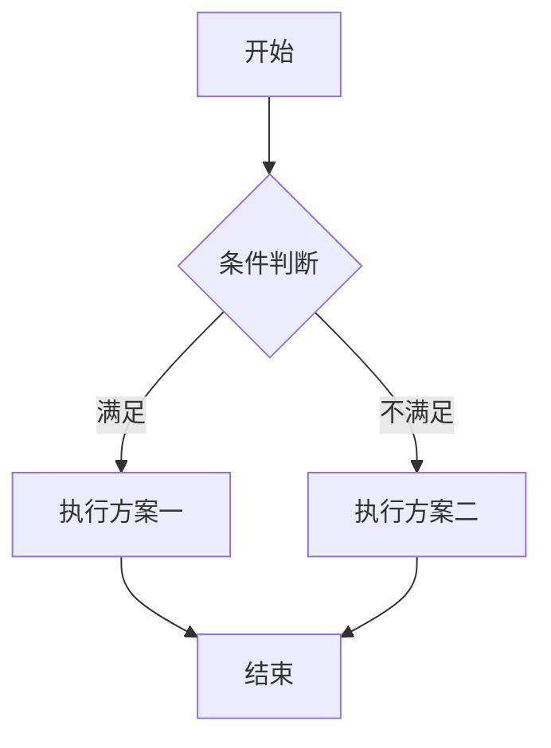
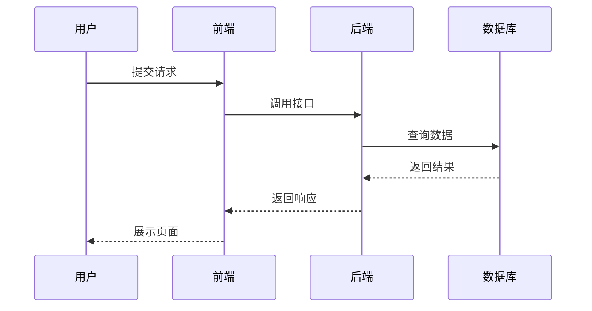
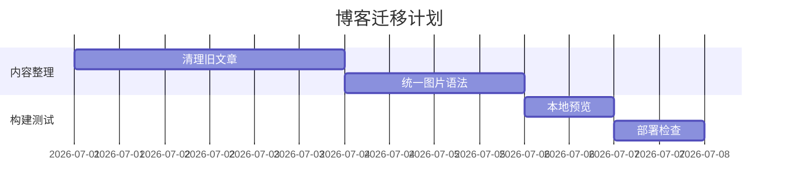

This article is organized by the original Markdown Basic Curriculum, the Markdown Extensions and the Mermaid Charts. The original articles are more like a full grammar list, with a more fragmented content; the part of the blog that is really used is combined into a Chinese quick check note that can be directly referenced in Obsidian and Quartz.

## Markdown is good for something.

Markdown does not aim to replace Word or LaTeX, but to write structured with as few tags as possible. The most common typesetting used to blog is not complex layouts, but the consistent expression of titles, paragraphs, lists, references, codes, tables, pictures and links.

Its advantages are:

- Source is a plain text suitable for Git management and long-term preservation.
- The grammar is simple enough to be written without frequent departure from the keyboard.
- You can edit in the Obsidian or be built into a web page by Quartz.
- If complex content is required, formulae, code highlights, Callout and Mermaid charts can be inserted through an extended syntax.

## Base block syntax

### Title

Title Use `#` . A normal article retains only one level-I title, and the body is organized more clearly from the secondary heading.

```markdown
# 一级标题
## 二级标题
### 三级标题
```

In Quartz, the title of the article is usually given by YaML head `title` field control, so there is no need to write a first-level heading in the text.

### Paragraphs and line breaks

A blank line between the ordinary text would create a new paragraph.

```markdown
这是第一段。

这是第二段。
```

If you want to change lines manually in the same paragraph, you can enter two spaces at the end of the line, but more often than not, direct subparagraphs are recommended and the source code is easier to read.

### Reference

Reference Use `>` At the beginning, it is appropriate to place a note, extract from the original text or additional information.

```markdown
> 这是一段引用。
> 
> 引用中也可以继续写 **加粗**、列表和链接。
```

The effects are as follows:

> This is a quote.
>
> You can continue writing in the quote. **Bold**, lists and links.

### List

No Sequence Tables Available `-`, use the orderly list `1.`、`2.`。

```markdown
- 第一项
- 第二项
- 第三项

1. 第一步
2. 第二步
3. 第三步
```

It is recommended that blogs should be used to harmonize list symbols as much as possible in the same article, for example, without a sequenced table `-`。

### code block

Inline code uses inverse marks, code black uses three inverse marks. Code black can be followed by a name in a language that Quartz can highlight.

````markdown
行内代码：`npm run build`

```python
def hello(name: str) -> str:
    return f"Hello, {name}"
```
````

The effects are as follows:

```python
def hello(name: str) -> str:
    return f"Hello, {name}"
```

### Table

Table Use `|` Separate Columns, Second Line `---` Distinguishing the header from the face. A colon controls the alignment.

```markdown
| 语法 | 用途 | 备注 |
| :--- | :---: | ---: |
| `#` | 标题 | 左对齐 |
| `>` | 引用 | 居中 |
| ``` | 代码块 | 右对齐 |
```

The effects are as follows:

| Syntax: | Use | Remarks |
| :--- | :---: | ---: |
| `#` | Title | Left |
| `>` | Reference | Centred |
| ` ``` ` | code block | Right |

Tables are suitable for displaying a small amount of structured information.

## Word

### Highlight and Strikeout

```markdown
*斜体*
**加粗**
~~删除线~~
```

The effects are as follows:*Italic*、**Bold**、~~Strikeout~~。

### Link

The basic method of the link is `[显示文字](链接地址)`。

```markdown
[Quartz 文档](https://quartz.jzhao.xyz/)
```

If you are in-site, you can write a relative path or an internal link form supported by Quartz/Obsidian. To move and build stability, I prefer to use a clear path in my blog.

### Picture

The syntax and the link are similar, just one more in front. `!`。

```markdown

```

In the current blog, a separate Markdown picture is converted to a picture with a graph: text in square brackets is shown as the name below the picture. This is better suited to maintain it in Obsidian than handwritten HTML.

### Transfer

If you want to display special characters in Markdown, you can use a reverse slash.

```markdown
\*这不是斜体\*
\# 这不是标题
```

## Extended Syntax in Quartz and Obsidian

### Callout

Callout is suitable for tips, warnings and additional instructions. The Obsidian style is written as follows:

```markdown
> [!NOTE]
> 这是一条普通提示。

> [!WARNING]
> 这里可以写需要注意的风险。
```

The effects are as follows:

> [!NOTE]
> It's a simple hint.

> [!WARNING]
> Here's the risk that needs attention.

### Collapse Description

If it is long, you can use foldable Callout.

```markdown
> [!EXAMPLE]- 点击展开示例
> 这里可以放较长内容。
```

This writing is friendly in Quartz and Obsidian and is better than the compatibility of direct handwritten HTML.

### GitHub Link Card

The original extended grammar example mentions that some of the themes render the GitHub warehouse link into a card. For example:

```markdown
[matsuzaka-yuki/Mizuki](https://github.com/matsuzaka-yuki/Mizuki)
```

This effect depends on the theme or plugin support. When you migrate to Quartz, it will degenerate into a normal link without a corresponding plugin. Therefore, the key information should not be relied upon entirely on the card style.

### Spoiler

Selected thematic support `:spoiler[]` This kind of hidden text grammar:

```markdown
这是一段 :spoiler[默认隐藏的内容]。
```

It is also important to note that this is not Markdown standard syntax. If you change the subject or reflex, you may not be able to show the intended effect.

## Mermaid Chart

Mermaid can draw flow charts, time sequences, Gantt charts, class charts, and status maps in plain text. When writing a technical document, it is easier to maintain than a screenshot, because the chart itself is a text that can be tracked by Git.

### Flowchart

````markdown
```mermaid
graph TD
    A [commencing]-- > B {conditional judgement}
    B -->|Satisfy| C [IP I]
    B -->|Not satisfied| D [Implementing programme II]
    C---E-- [Crying]
    D --> E
```
````

The effects are as follows:



### Time series

Time sequence maps are suitable for describing the interaction between the user, front end, backend and database.



### Gantt chart

Gantt charts are suitable for project planning.



## Writing advice

Markdown is not about using all grammars, but about stabilizing the structure of the content. My suggestion is:

- Articles structure prioritizes the use of titles, paragraphs and lists, and does not rely excessively on HTML.
- Use Markdown or Obsidian default syntax as much as possible to preview in local editor.
- Tables are used only for short message comparisons and for long sections.
- Code black must write a language name that allows for highlighting and reproduction.
- Mermaid is suitable for expression processes and relationships and for carrying too many text.
- Non-standard extended grammar should be used with caution, and it would be useful to confirm that Quartz and Obsidian can be properly rendered.

Markdown’s most important value for individual blogs is to reduce the cost of writing and moving. As long as syntax is simple, document structure is clear, attachments are stable, an article can serve both the local knowledge base and online blogs.
